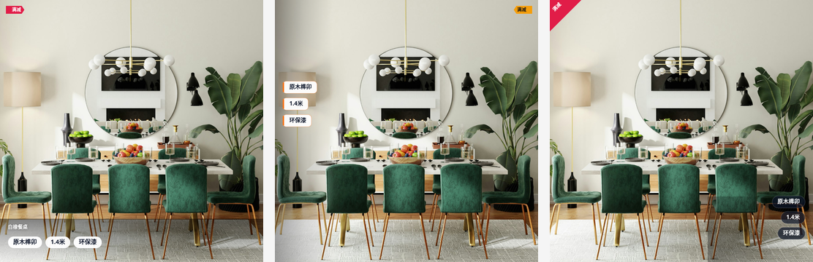
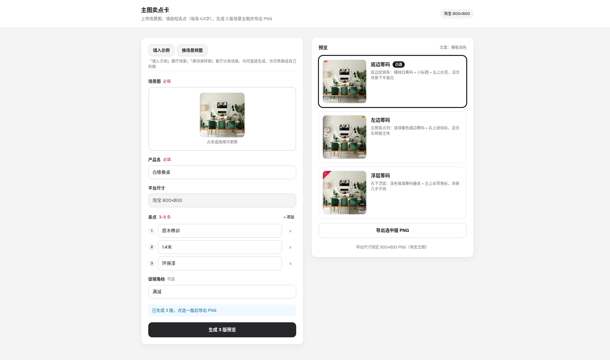

# 主图卖点卡

上传一张场景图，填产品名与短卖点，生成 3 版「场景图 + 卖点叠层」主图，并导出 PNG。支持 **淘宝 800×800**、**DTC 1080×1080**、**亚马逊 2000×2000**。

**在线试用：** [hero-selling-card.vercel.app](https://hero-selling-card.vercel.app)



左起：底边筹码 · 左边筹码 · 浮层筹码

## 怎么用

1. 打开线上地址，或本地 `npm run dev`
2. 点 **餐厅示例 / 客厅示例**（场景演示），或点 **真实 SKU**（如折叠床 folding-bed-01），也可拖入自己的场景图
3. 选择平台尺寸（淘宝 / DTC / 亚马逊）
4. 确认产品名、卖点（主图最多展示 3 条、每条 ≤6 字）、可选促销角标
5. 点 **生成 3 版预览**，选一版 **导出 PNG**



## 三版布局

| 布局 | 视觉重点 |
|------|----------|
| 底边筹码 | 底边促销条：横排白筹码 + 小标题 + 左上价签 |
| 左边筹码 | 左侧卖点列：竖排暖色描边筹码 + 右上琥珀标 |
| 浮层筹码 | 右下浮层：深色玻璃筹码 + 左上丝带角标 |

可选服务端文案改写；未配置 API Key 时用本地模板润色，仍可完整出图。

## 平台尺寸

| 平台 | 导出像素 |
|------|----------|
| 淘宝 | 800×800 |
| DTC | 1080×1080 |
| 亚马逊 | 2000×2000 |

三版布局按 800 基线设计，切换平台时等比缩放叠层与字号。

## 范围

**做：** 单图上传 → 三版 Canvas 合成 → 按平台导出方形 PNG  

**不做：** 多 SKU 批量、登录支付、飞书对接、像素级结构保真 / img2img、白底抠图目录排版

## 本地运行

```bash
npm install
npm run dev
```

打开 [http://localhost:3000](http://localhost:3000)。

生产构建：

```bash
npm run build && npm start
```

## 环境变量（可选）

复制 `.env.example` 为 `.env.local`。不配置也能走通：上传 → 生成 → 导出。

| 变量 | 说明 |
|------|------|
| `DASHSCOPE_API_KEY` | 通义兼容模式 Key（优先） |
| `DASHSCOPE_BASE_URL` | 默认 `https://dashscope.aliyuncs.com/compatible-mode/v1` |
| `DASHSCOPE_MODEL` | 默认 `qwen-plus` |
| `OPENAI_API_KEY` | 无 DashScope 时可用 |
| `OPENAI_BASE_URL` | 默认 `https://api.openai.com/v1` |
| `OPENAI_MODEL` | 默认 `gpt-4o-mini` |

密钥仅服务端使用，勿提交到 Git。

## 部署

本仓库已关联 Vercel 项目 **hero-selling-card**，推送到 `main` 即自动发版。

公开地址：[https://hero-selling-card.vercel.app](https://hero-selling-card.vercel.app)

若从零新建：在 Vercel Import 本仓库 → Framework 选 Next.js → 按需加环境变量 → Deploy。
